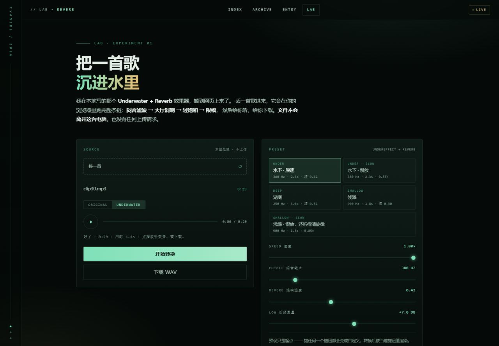

# Cyanide Site · 个人博客 + Reverb Lab

纯静态的个人博客：没有构建步骤、没有依赖、没有后端。文章在 Notion 里写，页面在这里落地。

**线上** · <https://cyanide-blog.surge.sh>
**镜像** · <https://cyanidenahida.github.io/cyanide-site/> （GitHub Pages）
**[Reverb Lab](https://cyanide-blog.surge.sh/Reverb)** · 把一首歌丢进浏览器，变成水下大厅混响




---

一个纯静态的个人博客：没有构建步骤、没有依赖、没有后端。
双击 `index.html` 就能看，扔到任何静态托管上就能上线。

---

## 一、怎么看

**最省事**：双击 `index.html`。

**想更接近真实环境**（推荐，避免个别浏览器对本地文件的限制）：

```powershell
cd "D:\DSH-Workspace\cyanide-blog"
python -m http.server 8765
# 然后浏览器打开 http://127.0.0.1:8765
```

首页会先播一段启动动画（约 2 秒），点一下屏幕可以跳过。
调试时想跳过动画，地址后面加 `?noload=1`。

---

## 二、里面有什么

```
cyanide-blog/
├─ index.html          首页：启动动画 + 主视觉 + 文章流 + 侧栏
├─ archive.html        归档页：按时间列出全部文章，可按标签筛
├─ article.html        文章页：这是"一篇长文"的模板
├─ assets/
│  ├─ css/style.css    全部样式（约 23 KB，一个文件搞定）
│  ├─ js/app.js        只干三件事：启动动画、滚动渐显、顶栏滚动状态
│  └─ img/*.webp       15 张图已压缩成 webp，共约 1.2 MB
├─ Reverb.html          ★ Lab：水下混响效果器（/Reverb 这个网址就是它）
├─ reverb.css            Lab 自己的样式
├─ reverb.js             Lab 的 Web Audio 效果链（全部在浏览器里跑）
├─ underwater-effect/   旧网址的跳转页，会自己转到 /Reverb
├─ CNAME                域名锚点，发布时别删
└─ README.md            就是本文件
```

配色取自纳西妲（草绿 + 深墨绿 + 米金），版式参考 endspace。
字体走系统字体，不联网加载任何外部资源 —— 断网也能正常显示。

---

## 三、改站名和自我介绍

打开 `index.html`，搜索这些位置直接改文字：

| 想改什么 | 改哪里（index.html 里搜） |
|---|---|
| 浏览器标签页标题 | `<title>CYANIDE · 记录我学到的每一个碎片</title>` |
| 主标题两行大字 | `<h1>记录我学到的<br><span class="accent">每一个碎片</span></h1>` |
| 标题下的那段话 | `<p class="lede">…</p>` |
| 侧栏名字 | `<b>CYANIDE</b>` |
| 侧栏小字 | `<span>Writer / 学 徒</span>` |
| 侧栏简介 | `<p class="bio">…</p>` |
| 侧栏标签 | `<div class="tags">` 里的四个 `<span>` |
| 页脚 | `<footer class="foot">` |

改完全站三个页面里的同一处（`index.html` / `archive.html` / `article.html` 的顶栏和页脚是各写一份的），
**注意：没有模板引擎，所以是手工同步三处。**

---

## 四、加一篇新文章

只有两步：**在归档页加一行，再复制出一个新的文章页**。

### 1) 复制文章页

把 `article.html` 复制一份，改名成比如 `posts/ai-note.html`（`posts` 文件夹需要你自己新建），
然后改这几处：

```html
<title>你的标题 · CYANIDE</title>

<!-- 封面图（换成 assets/img/ 里的任意一张，或你自己放进去的图） -->
<div class="art-top"><div class="art-cover"></div></div>

<!-- 标签 / 日期 / 阅读时长 -->
<div class="art-meta">
  <span class="tag">碎碎念</span>
  <time>2026.11.01</time>
  <span>约 3 分钟</span>
</div>

<!-- 大标题 -->
<h1>这里写标题</h1>

<!-- 正文：<div class="prose"> 里面随便写，下面的标签都能用 -->
```

正文里可用的写法（都是普通 HTML）：

| 想要的效果 | 写法 |
|---|---|
| 小标题 | `<h2>小标题</h2>` |
| 段落 | `<p>一段话</p>` |
| 强调 | `<strong>重点</strong>` / `<em>斜体</em>` |
| 行内代码 | `<code>yarn build</code>` |
| 引用 | `<blockquote><p>一句话</p></blockquote>` |
| 列表 | `<ul><li>条目</li></ul>` |
| 插图 | `<figure><figcaption>图注</figcaption></figure>` |

### 2) 在归档页登记

打开 `archive.html`，在 `<div class="arch-list">` 里加一行（放最上面）：

```html
<a class="arch-row" href="posts/ai-note.html" data-tags="AI">
  <time>2026.11.01</time>
  <span class="tag">AI</span>
  <h3>这里写标题</h3>
  <span class="arch-go">→</span>
</a>
```

`data-tags` 决定它归到哪个筛选项下；想加新标签，就在上面的 `.arch-filters` 里再补一个 `<button class="chip" data-tag="新标签">`。

### 3) 首页也放一条（可选）

`index.html` 里 `<article class="post">` 那一整块，复制一份改文字和封面即可。三篇是手工排的，不做自动分页。

---

## 五、换图

`assets/img/` 里现在是 15 张原神纳西妲同人图，已按用途裁好并压成 webp：

| 文件 | 用在哪 |
|---|---|
| `hero.webp` | 首页主视觉（1920×960） |
| `loading.webp` | 启动动画背景 |
| `avatar.webp` | 侧栏头像（正方形） |
| `cover-1/2/3.webp` | 首页三篇文章的缩略图（16:10） |
| `square-6/8/9/14.webp` | 侧栏四宫格 |
| `thumb-*.webp`、`tower.webp` | 备用，暂时没用到 |

换图建议：**先把图压成 webp、宽度控制在 1600px 以内**，再放进 `assets/img/` 覆盖同名文件，页面不用改。
原图还在 `C:\Users\lenovo\Desktop\vibe coding\Cyanide\blog\`（1.png ~ 15.jpg）。

---

## 六、已经上线了（2026.10.29）

**线上地址：<https://cyanide-blog.surge.sh>**

托管在 Surge（免费静态托管）。账号、密码、怎么换自定义域名，写在
Desktop\vibe coding\Cyanide\上线信息-请读.md。

改完内容、想让它上线，只要一条命令：

```powershell
cd "C:\Users\lenovo\Desktop\vibe coding\Cyanide\site"
npx surge . cyanide-blog.surge.sh
```

（目录里的 `CNAME` 文件是域名的锚点，**别删**。）

> 备选：Netlify Drop（app.netlify.com/drop 拖文件夹）、Cloudflare Pages、
> 或者哪天 GitHub 通了再上 Vercel。都是同一个文件夹，换个地方放而已。

## 七、Lab：把一首歌沉进水里（<https://cyanide-blog.surge.sh/Reverb>）

把隔壁那个 Python 版水下混响（`D:\DSH-Workspace\EXECUTION\underwater-fx`）的效果链
用 Web Audio 重写了一遍，塞进浏览器里跑。上传音频 → 选预设 → 转换 → 试听 → 下载 WAV，
**文件不上传、不出这台电脑**（页面里没有任何请求外部服务器的代码）。

| 文件 | 管什么 |
|---|---|
| `Reverb.html` | 页面结构（拖放区、预设、旋钮、播放器） |
| `reverb.css` | 这一页的样式；配色变量在主站 `assets/css/style.css` 里 |
| `reverb.js` | 效果链本体：滤波 → 卷积混响 → 抖动 → 饱和 → 限幅 → 拼 WAV |

效果链顺序（和 Python 版 `uxfx/dsp.py` 一致）：
28 Hz 高通 → 140 Hz 低架 +7 dB → 650 Hz 挖 −3.5 dB → 闷音低通 → 2.6 kHz 高架 −8 dB →
5.6 kHz 低通 ×2（24 dB/oct）→ 合成大厅混响（45 ms 预延迟）→ 0.18 Hz 抖动 →
tanh 饱和 → 压缩 → 侧向收窄 → RMS 对齐 −14 dBFS → 16-bit WAV。

**改预设**：`reverb.js` 里搜 `PRESETS`，五个预设一眼能看懂——
`cutoff`（闷音截止 Hz）、`wet`（混响湿度 0–1）、`speed`（速度倍率）、`room`（混响时长秒）、`low`（低频增益 dB）。

**播放器**：进度条可以点，也可以按住往左右拖（拖动时时间跟着走，松手后如果之前在播就接着播）；
键盘聚焦进度条后用 ← → 跳 5 秒，Home / End 跳首尾。

**边界**：一次最多 5 分钟（`MAX_SEC = 300`），只吃音频（mp3/wav/flac/m4a/ogg），
导出是 WAV（不压 mp3，因为浏览器里没有 mp3 编码器）。手机浏览器也能跑，但长音频会慢一些。

---

## 八、已知边界

- **纯静态**：没有后台、没有评论、没有搜索。文章是手写的 HTML，不是从 Notion 自动同步的。
- **Notion 自动同步**（也就是你 5 月原本想做的事）需要跑 NotionNext 那一套 Next.js 项目，
  要装依赖、要配 `NOTION_PAGE_ID` 和 `NOTION_ACCESS_TOKEN`、要在 Vercel 上构建。
  那条路随时可以再走一次，但先有一个"能看的东西"比先有一套"能自动同步的系统"重要。
- 三篇文章是**样式示例**，不是你的真实内容。等你写第一篇的时候，把示例删掉就行。

### 与桌面 Python 版的音质对齐（2026-10-29 修）

上一版网页 DSP 有两处硬件性错误，是「听着粗糙、炸耳朵」的原因：

1. 滤波链末尾挂了 `WaveShaper`（tanh 饱和）和 `DynamicsCompressor`——Python 版根本没有压缩器，
   饱和又把谐波顶到 6–12 kHz，所以高频发刺、动态被压平（crest 从 4.5 掉到 2.3）。
2. 干声增益写成了 `1 - wet`，Python 版恒为 1；预设只存了 5 个参数，`lp_res / mid / bass / hf / top /
   predelay / drive / width / lufs` 全丢了。

现在已经整体重写：滤波链、混响 IR（6 频带 tau 衰减 + 早期反射 + 能量归一）、软饱和、中侧收窄、
EBU R128 门控响度对齐、12ms 前视限幅，全部按 `uxfx/dsp.py` 一比一实现，滤波响应对 Python 的
解析响应误差 0.00 dB。实测母带响度 -13.0 LUFS（参考 -13.1）。

复测方法：

```powershell
# 网页版导出 WAV（可选第 6 个参数覆盖旋钮，如 '{"wet":0}'）
node tools\cdp-lab-wav.js http://127.0.0.1:8765/Reverb.html <音频> out\web.wav under
# Python 参考
python tools\ref-python.py <音频> out\ref.wav under 30
# 比对（倍频程能量 / crest / LUFS）
python tools\compare-wav.py out\ref.wav out\web.wav
```

注意：无头 Chrome 一定要用**唯一**的 `--user-data-dir`，否则会缓存 `reverb.js`，改完代码渲染结果不变。
